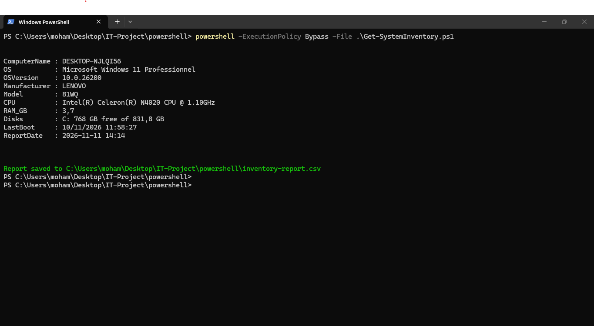
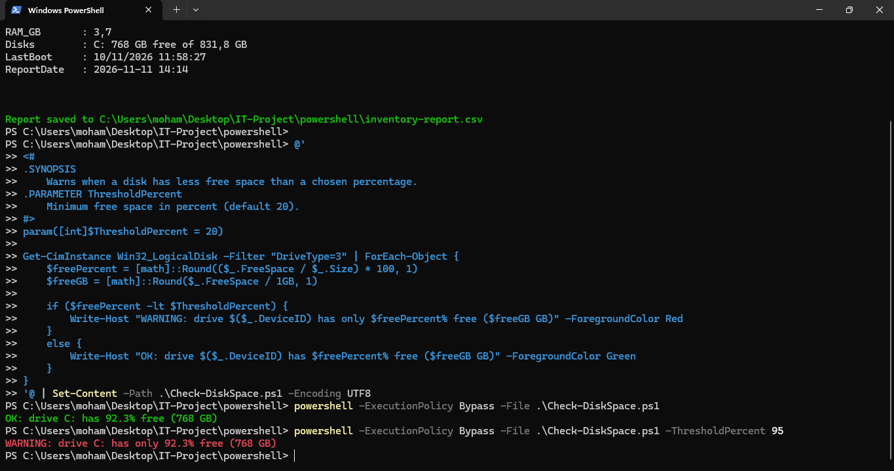
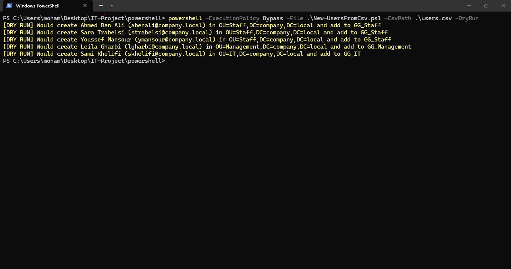

# Phase 3 — PowerShell Automation

This phase contains three PowerShell scripts for common IT support and system administration tasks.

## Scripts

| Script | Purpose | Test status |
|---|---|---|
| [Get-SystemInventory.ps1](scripts/Get-SystemInventory.ps1) | Collects computer, operating system, hardware, and disk information; exports a CSV report | Tested on a Windows 11 PC |
| [Check-DiskSpace.ps1](scripts/Check-DiskSpace.ps1) | Reports whether each fixed disk is above or below a free-space threshold | Tested on a Windows 11 PC |
| [New-UsersFromCsv.ps1](scripts/New-UsersFromCsv.ps1) | Creates Active Directory users from a CSV file and adds them to department groups | Dry-run mode available; revised script not yet tested against a live domain |

## Requirements

- Windows PowerShell
- For the Active Directory user-creation script: a domain-joined or domain-admin workstation with the Active Directory PowerShell module and permission to create users in the target OUs.

## Usage

Run these commands from the `03-powershell` directory.

System inventory:

```powershell
.\scripts\Get-SystemInventory.ps1
```

Disk-space check (warn below 20% free):

```powershell
.\scripts\Check-DiskSpace.ps1 -ThresholdPercent 20
```

Preview user creation without changing Active Directory:

```powershell
.\scripts\New-UsersFromCsv.ps1 -CsvPath .\scripts\users.csv -DryRun
```

The script checks that the CSV contains `FirstName`, `LastName`, `Username` and `Department`. It accepts the `Staff`, `Management` and `IT` departments, skips invalid or duplicate rows, and reports separately if an account is created but group membership fails. The dry run validates the input and previews the planned actions; it does not verify that the target OUs or groups exist in Active Directory.

## Results

**System inventory**



**Disk-space check**



**Active Directory user creation dry run**



## Testing limitations

The system inventory and disk-space scripts were tested on a real Windows 11 PC. The revised user-creation script has not yet been executed against a live domain controller. Its `-DryRun` option previews valid rows without changing Active Directory; the Active Directory cmdlets and target OU/group configuration still require validation in a test domain.
